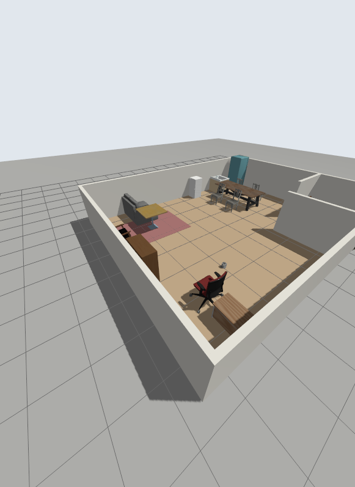

# Tutorial: from an empty machine to the simulation experiment

Build the Lean-backed `twist_mux` and use turtlesim to see how it handles
planner commands, keyboard input, and a stop lock. See the
[README](../README.md#quick-start) for disk space and platform results.

## 1. Install the two tools

Nothing else is needed: no system ROS, no compiler set-up. The commands are
the same on macOS and Linux; on Linux you need `curl` and `git`
(`sudo apt install curl git` on Ubuntu).

```sh
# Lean's toolchain manager. Accept the defaults.
curl https://elan.lean-lang.org/elan-init.sh -sSf | sh

# pixi, which installs ROS 2 Jazzy (from RoboStack) into the project folder.
curl -fsSL https://pixi.sh/install.sh | sh
```

Open a new terminal so that both are on `PATH`, then check:

```sh
lake --version
pixi --version
```

If either is "not found", add `~/.elan/bin` and `~/.pixi/bin` to your `PATH`.

## 2. Get the code

```sh
git clone -b collision-monitor https://github.com/Beneficial-AI-Foundation/ROSlean.git
cd ROSlean
```

All commands from here on are run in this folder.

## 3. Build

```sh
pixi run build
```

The first build downloads the ROS environment and Lean toolchain. Lean
compiles the core to C. Colcon builds four packages from `ros/`:
`roslean_core`, `roslean_twist_mux`, `roslean_collision_monitor`, and
`roslean_noop`.

## 4. Test against the original node (optional)

```sh
pixi run test
```

The full suite tests both nodes and took about 40 minutes in the audit.
For just the mux scenarios and comparison, run this from the repository
root after building:

```sh
pixi run bash -c 'source install/setup.bash &&
  colcon test --base-paths ros --packages-select roslean_twist_mux --event-handlers console_direct+ &&
  colcon test-result --test-result-base build/roslean_twist_mux --verbose'
```

The mux tests compare forwarding decisions on scripted and random inputs
under a simulated clock.

## 5. Check the proofs (optional)

```sh
pixi run prove
```

The first run downloads Mathlib's compiled cache. It ends with
`Build completed successfully`. A theorem that did not hold would be an
error here. The statements are in `ROSlean/Mux/Properties.lean`; start with
`forward_iff`.

## 6. The experiment

The set-up:

```
planner (priority 10)  ─┐
teleop  (priority 100) ─┼─▶ twist_mux ─▶ turtle
e-stop lock (255)      ─┘
```

The planner is a script that asks for a circle ten times a second. Teleop is
your keyboard. The e-stop is a lock: while it is on, inputs below its
priority are dropped. An input counts as live for 0.5 s after its last
message.

### Start it

Terminal 1:

```sh
pixi run demo
```

A window with a turtle opens and the turtle starts to circle. The terminal
shows the narrator, which reports who is driving and names the theorem that
explains it:

```
>>> planner drives: it is the only live input and no lock is active
    theorem forward_of_highest_live
```

macOS may ask whether to allow incoming network connections; allow it (ROS
nodes talk to each other over the local network). On Linux the window needs
a graphical session (X11 or Wayland); over SSH without one, turtlesim exits
with `could not connect to display`.

### Take over with the keyboard

Terminal 2, in the same folder:

```sh
pixi run demo-teleop
```

Keep this terminal focused and hold `i` (forward), `j` or `l` (turn). While
you hold a key the turtle follows the keyboard, and terminal 1 shows:

```
>>> teleop drives; planner messages are dropped while teleop is live
    theorems forward_of_highest_live, run_not_forward_of_higher_live
```

The planner is still publishing; its messages are being dropped.

### Let go

Release the key. The turtle stops for half a second, then resumes the circle:

```
>>> nothing is forwarded: teleop went silent but counts as live until its 0.5 s
    timeout has passed, so the planner is still suppressed
    theorem inputLive_iff_le

>>> planner drives: it is the only live input and no lock is active
    theorem forward_of_highest_live
```

This pause is the timeout rule: a silent input keeps its claim until its
timeout has passed, and not a moment longer.

### Emergency stop

Terminal 3:

```sh
pixi run demo-estop
```

The command waits until the mux and the narrator are both listening, sends
the lock message five times and returns after about a second. The turtle
freezes, whether or not you are holding a key:

```
>>> e-stop lock ENGAGED

>>> nothing is forwarded: the e-stop lock (255) is above every input
    theorem not_forward_of_top_lock
```

Try the keyboard in terminal 2: nothing moves. Then release the lock:

```sh
pixi run demo-release
```

and the planner (or the keyboard, if you are holding a key) drives again.

Stop everything with Ctrl-C in terminals 1 and 2.

### What you just saw

| You did | The turtle | Rule (docs/SPEC.md) | Theorem |
| --- | --- | --- | --- |
| Nothing | Circles | The highest live input is forwarded | `forward_of_highest_live` |
| Held a key | Follows the keyboard | A lower input is dropped while a higher one is live | `run_not_forward_of_higher_live` |
| Released the key | Pauses 0.5 s, then circles | Live up to and including the timeout | `inputLive_iff_le` |
| Engaged the e-stop | Freezes | A lock above every input blocks them all | `not_forward_of_top_lock` |

The theorems are about the Lean function `step`. The node calls the compiled
form of that same function for every message; the C++ around it only reads
parameters, subscribes, reads the clock and publishes.

## 7. Go further

**Compare with the original node.** Run the same experiment on upstream's
`twist_mux`; it should behave the same:

```sh
pixi run bash -c 'source install/setup.bash && \
  ros2 launch roslean_twist_mux demo_launch.py mux_package:=twist_mux'
```

**Watch the messages.** While the demo runs, in another terminal:

```sh
pixi run bash -c 'source install/setup.bash && ros2 topic echo /turtle1/cmd_vel'
```

**Change the configuration.** The demo's inputs and priorities are in
`ros/roslean_twist_mux/demo/demo.yaml`. For example, give `teleop` priority
255 and restart the demo: the e-stop no longer stops the keyboard, because a
lock blocks only *strictly* lower priorities. The node warns about this at
start-up.

**Break a rule and watch the proofs object.** In
`core/ROSleanCore/Mux.lean`, in `expired`, change `stamp + timeout < now` to
`stamp + timeout ≤ now`. Then:

```sh
pixi run prove
```

fails: first the worked examples in `ROSlean/Mux/Examples.lean` that sit
exactly on a timeout boundary, and the theorems that state the boundary.
Undo the change afterwards.

**Read on.** `twist_mux.md` has a reading order for the code and proofs.

## 8. The same experiment in Gazebo

A more realistic setting: a TurtleBot3 with a lidar in a furnished
apartment, simulated with physics, with either a patrol script or Nav2 as
the planner. It has its own tutorial:
[TUTORIAL_GAZEBO.md](TUTORIAL_GAZEBO.md).



## 9. Without pixi: the Docker build (Linux)

Docker builds both nodes for ROS 2 Jazzy on Ubuntu 24.04 and runs the tests available in the image. The runtime image includes the installed nodes and their dependencies.

```sh
docker build -f docker/Dockerfile -t roslean-twist-mux .
docker run --rm --network host roslean-twist-mux
```

The second command starts the node with the example configuration. See the
README for running it with your own parameter file.

## If something goes wrong

| Symptom | Likely cause |
| --- | --- |
| `pixi: command not found` or `lake: command not found` | New terminal needed, or `~/.pixi/bin` / `~/.elan/bin` not on `PATH`. |
| The keyboard does nothing | Terminal 2 is not focused, or the key is not held: a single key press is one message, and teleop expires 0.5 s later. |
| `pixi run demo-estop` prints `Waiting for at least 2 matching subscription(s)` and does not return | The demo is not running (terminal 1), or it was started on another machine or `ROS_DOMAIN_ID`. Stop the command with Ctrl-C. |
| `could not connect to display` (Linux) | There is no graphical session. Run the demo from a terminal on the desktop, not over plain SSH. |
| Narrator prints `UNEXPECTED` | A message was forwarded while the lock was on. That would contradict `not_forward_of_top_lock`; please report it with the terminal output. |
