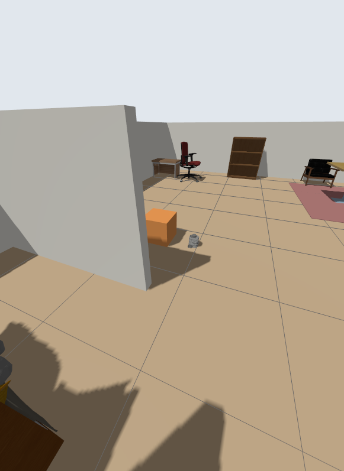
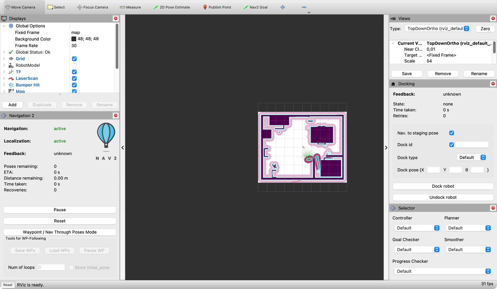

# Tutorial: the collision monitor in Gazebo

Run the mux and collision monitor on a TurtleBot3 in Gazebo. The robot
slows and stops when a box enters its zones, then resumes when the box
is removed. Step 7 shows how Nav2 can launch the Lean monitor.

First [install the tools and build](TUTORIAL_GAZEBO.md#2-get-the-code-and-build).
Allow about 20 minutes after setup. The demos and checks below were run
on macOS arm64. An earlier version of the box check also ran on Linux
x86-64 with a virtual display. The [mux demo clip](../site/media/cm_gazebo_window.mp4)
and [Nav2 clip](../site/media/cm_nav2_window.mp4) show the box scenarios.

## 1. What is in the simulation

```
planner (priority 10)  ─┐
teleop  (priority 100) ─┼─▶ twist_mux ─▶ collision monitor ─▶ base watchdog ─▶ robot
e-stop lock (255)      ─┘                       ▲
                                         lidar ─┘
```

The apartment, the robot, the patrol, the mux and its configuration, and the
base watchdog are those of the Gazebo tutorial; the launch file of this demo
uses them from where `roslean_twist_mux` installs them. New are:

- **The collision monitor** (`roslean_collision_monitor`), between the mux
  and the base. It is a replacement for the core of Nav2's
  `nav2_collision_monitor`; what it supports is listed in
  [collision_monitor/SPEC.md](collision_monitor/SPEC.md).
- **Two zones** in front of the robot, in
  `ros/roslean_collision_monitor/demo/gazebo/monitor.yaml`:

  ```
            y (left, m)
       0.22 ┌────────────────────────────────────────────┐
       0.14 │ ┌────────────────────┐                     │
            │ │  [robot]▶   Stop   │   Slow: command × 0.4
      -0.14 │ └────────────────────┘                     │
      -0.22 └────────────────────────────────────────────┘
          -0.14       0           0.30                  0.70   x (ahead, m)
  ```

  If at least four lidar points lie in the stop zone, the monitor demands zero. After the stop publication timeout it withholds velocity until the demand changes. Otherwise, if at least four lie in the slowdown zone,
  the command is multiplied by 0.4. Otherwise it passes unchanged. The robot
  itself reaches from x = −0.10 to x = +0.04.
- **A box**, 0.4 m on each side, which a script puts in front of the robot
  and removes again (`obstacle.py`). It uses the simulator's own services, so
  the monitor learns of the box only through the lidar.
- **A second narrator** (`monitor_narrator.py`), which reports what the
  monitor does to the command and names the theorems that explain it. The
  mux narrator of the Gazebo tutorial runs next to it.

### Where the lidar is

The lidar's scans are in the frame `base_scan`; the zones are in the base
frame, `base_footprint`. The Lean node asks TF for the transform between the
two, as upstream's monitor does, and applies it to every reading.
`robot_state_publisher` provides the transform from the robot's URDF, which
the launch file gives it: in `turtlebot3_description`'s
`turtlebot3_burger.urdf`, `base_joint` puts `base_link` at xyz (0, 0, 0.010)
in `base_footprint`, and `scan_joint` puts `base_scan` at xyz
(−0.032, 0, 0.172) in `base_link`, both without rotation. So the lidar is
3.2 cm behind the base's origin, on the centre line, facing forward. The
simulated sensor in `turtlebot3_gazebo`'s `model.sdf` is at the same x and
y.

(Before the node could read TF, the pose was a parameter of its own in
`monitor.yaml`, `roslean_sensor_pose`. That parameter is gone; nothing in
the demo sets the pose by hand any more.)

## 2. Start it

Terminal 1:

```sh
pixi run cm-gazebo-scenario
```

A Gazebo window opens, the room fills in (the first launch downloads the
furniture, see the Gazebo tutorial) and the robot starts its patrol. With
`scenario:=true`, which this task sets, the box appears by itself.

## 3. Experiment 1: the box, without touching anything

Watch terminal 1. First both narrators report the normal state:

```
>>> planner drives: it is the only live input and no lock is active
    theorem forward_of_highest_live

>>> monitor: the command passes unchanged; no zone is occupied
    theorems run_pass_through, velocity_eq_pass_iff
```

When the robot has turned the first corner and drives straight with two
metres of free floor ahead, the script drops an orange box 1.2 m in front of
it:

```
[obstacle] box dropped 1.2 m ahead of the robot, at (0.37, -1.65)
```

The robot drives on at full speed for half a metre. Then the box is in the
slowdown zone and the robot continues at 40 % of its speed:

```
>>> monitor: SLOWDOWN, the command is published times 0.40: the slowdown zone is
    occupied and the stop zone is not
    theorems velocity_eq_slowdown_iff, run_slowdown_bound, run_no_amplification
```

About five seconds later the box reaches the stop zone and the robot stops,
a quarter of a metre from the box:

```
>>> monitor: STOP, zero is published instead of the command: scans are arriving, so
    the stop zone is occupied
    theorems evaluate_isStop_iff, run_stop, stop_not_pass_or_slowdown

[obstacle] the robot is at rest, 0.26 m from the box; the box stays for 6 s
```


*The Gazebo window at that moment, captured from the screen, with the
camera moved next to the robot (see the top of this page). The run as a
clip: [cm_gazebo_window.mp4](../site/media/cm_gazebo_window.mp4).*

The patrol does not know any of this and keeps commanding 0.18 m/s. One
second later the monitor's output changes once more:

```
>>> monitor: publishes NOTHING although commands arrive: it has published zero for
    stop_pub_timeout and a stop is still demanded. The last message the base got
    is a zero; holding the robot is now the base watchdog's job (SPEC R15, A3)
    theorems velocity_eq_none_iff, run_withheld_last_published_zero
```

This is upstream's behaviour and the Lean node reproduces it: zero is
published for `stop_pub_timeout` (here 1 s) and then nothing, until a
velocity other than zero is due again. Step 6 says what that means for the
robot.

After six seconds the script removes the box, and the robot drives on:

```
[obstacle] box removed

>>> monitor: the command passes unchanged; no zone is occupied
    theorems run_pass_through, velocity_eq_pass_iff

[obstacle] the robot drives on
```

Near the edge of a zone the narrator can report STOP, SLOWDOWN and STOP in
quick succession. The simulated lidar has noise (a standard deviation of
1 cm on each range), so while the face of the box is within a centimetre or
two of the zone's edge, one scan has four points inside and the next has
not. The robot then creeps forward for a fifth of a second and is stopped
again, further inside.

The script is done after one box. For more, use the commands of the next
step. Stop everything with Ctrl-C before going on.

## 4. Experiment 2: by hand, with keyboard and e-stop

Terminal 1:

```sh
pixi run cm-gazebo
```

Terminal 2, whenever the robot drives straight and has room ahead:

```sh
pixi run cm-box-drop      # a box 1.2 m in front of the robot, wherever it is
pixi run cm-box-remove    # take it away
```

The narrator's output is that of step 3. A box dropped while the robot
turns a corner is simply left behind; remove it and try again.

**The monitor gates whoever the mux picked.** Start the keyboard in
terminal 3 (`pixi run gazebo-teleop`), drop a box, and hold `i` to drive at
it. The mux now forwards your commands and drops the patrol's; the monitor
slows and stops the robot in front of the box all the same, and no key gets
it closer. (Checked with a script publishing 0.2 m/s on the keyboard's
topic: 0.20 m/s before the box, 0.08 m/s in the slowdown zone, at rest
0.27 m from the box with the commands still arriving.)

No key gets it away either: in the stop zone *every* command becomes zero,
including backing up and turning. The box has to go. That is how upstream's
`stop` action works as well; its `approach` and `limit` actions, which this
node does not have, are the ones that let a robot manoeuvre near an
obstacle.

**With the e-stop on, the monitor is idle.** `pixi run demo-estop` makes
the mux forward nothing, so the monitor receives no command and publishes
nothing:

```
>>> e-stop lock ENGAGED

>>> nothing is forwarded: the e-stop lock (255) is above every input
    theorem not_forward_of_top_lock

>>> monitor: no command arrives, so nothing is published, whatever the lidar sees
    (the monitor acts only on commands: SPEC R1)
    theorem output_of_not_cmd
```

`pixi run demo-release` brings both back.

## 5. The automated check

```sh
pixi run cm-check
```

runs step 3 without windows and checks it against the simulator's ground
truth. It takes about half a minute and ends with `PASSED` or `FAILED`:

```
1. Free driving (the two seconds before the box)
  ok    the monitor passed all 20 commands unchanged
  ok    true speed 0.169 m/s (planner commands 0.18 m/s)

2. Slowdown zone
  ok    54 commands were published times 0.4
  ok    10 non-zero commands were answered with zero
  ok    the slowdown came before the stop
  ok    true speed in the slowdown zone 0.072 m/s (42% of the free speed; 5.4 s)
        slowdown began with the box 0.647 m from the robot

3. Stop zone
  ok    from the first zero until the box was removed, no command passed unchanged
        the decision went back from stop to slowdown 0 time(s) (lidar noise at the edge of the zone)
  ok    the robot was at rest when the box was removed, 6.2 s after it had come to rest, and moved 0 mm in between
  ok    the robot never touched the box: smallest gap 0.255 m
        first zero published with the box 0.256 m from the robot
        stopping distance 0.001 m, from the first zero to rest
        at rest 0.255 m from the box (the front edge of the stop zone is 0.262 m ahead of the robot)
        the monitor published 10 zeros over 0.90 s and was then silent for 6.2 s (stop_pub_timeout)

4. After the box was removed
  ok    45 commands passed unchanged
        first command passed 0.15 s after the removal
  ok    the robot drove on: 0.78 m in 4.6 s
  ok    and reached 0.178 m/s again

5. Whole run
  ok    none of the 205 published velocities exceeded its command or had the other sign
  ok    every published velocity was the command, zero, or the command times 0.4

PASSED in 32 s (27 s simulated)
```

How to read the numbers:

- *True speed* is the robot's displacement in the simulator divided by
  simulated time, not the commanded velocity and not the wheel odometry.
- *Stopping distance* is how far the robot still moved after the monitor's
  first zero. It includes any creeping at the zone's edge (step 3).
- *Gap* is the distance between the outline of the robot's collision shapes
  and the box. The front edge of the stop zone is 0.262 m ahead of the
  robot's front, so a gap at rest just below that means the robot stopped
  as soon as the box was in the zone.

In nine runs on an Apple M-series laptop, all passed. (These nine were
measured when the node still took the lidar's pose from a parameter. With
the node as it is now, which reads TF and is activated by a lifecycle
manager: three runs, three passed, gap when the slowdown began 0.635 to 0.665 m, first zero at
0.253 to 0.260 m, stopping distance 0 to 2 mm, at rest 0.254 to 0.260 m, no
flicker)

| | Range over nine runs |
| --- | --- |
| True speed before the box | 0.168 to 0.178 m/s |
| True speed in the slowdown zone | 0.071 to 0.072 m/s |
| Gap when the slowdown began | 0.626 to 0.653 m |
| Gap when the first zero was published | 0.256 to 0.273 m |
| Stopping distance | 0 to 14 mm |
| Gap at rest | 0.255 to 0.268 m |
| Runs in which the stop flickered once | 1 |

An earlier version of the check demanded that nothing but zero be published
after the first zero. It failed in two runs of five, because of the flicker
at the zone's edge described in step 3; the check now demands that no
command passes unchanged while the box is there, and that the robot moves
less than 3 cm after it has first come to rest.

The check is a script and not one of the `colcon` tests because Gazebo
renders the lidar and so needs a machine with a display, and the world
needs the furniture from Gazebo's online library.

## 6. Upstream's node, for comparison

```sh
pixi run bash -c 'source install/setup.bash && ros2 launch \
  $(ros2 pkg prefix roslean_collision_monitor)/share/roslean_collision_monitor/demo/gazebo/cm_gazebo_launch.py \
  scenario:=true monitor_package:=nav2_collision_monitor'
```

or, for the check, `pixi run cm-check --monitor nav2_collision_monitor`.
The same `monitor.yaml` and the same launch file are used: both are lifecycle
nodes, which do nothing until a `nav2_lifecycle_manager` has configured and
activated them, and both look up the lidar's pose in TF. Only the package
name differs.

The behaviour is the same and the check passed with it in four runs of
four (measured, like the table of step 5, before the Lean node read TF): at rest 0.253 to 0.257 m from the box, stopping distance 0 to 12 mm,
one run with a flicker. That is about half a centimetre closer than the Lean
node, which is the direction SPEC D4 predicts (the Lean node's zones are up
to 4.4 mm larger), but with this few runs and a lidar noise of 1 cm it is
not a measurement of that difference.
Upstream also writes a line to the log whenever the action changes (`Robot to
stop due to Stop polygon`); so does the Lean node, in the same words.

## 7. Nav2 starts the Lean monitor

Up to here the monitor was a gate of its own behind the mux, with a launch
file written for it. In this step **Nav2's own bring-up starts it in the
place of `nav2_collision_monitor`**: under Nav2's node name, with Nav2's
topics, configured and activated by Nav2's lifecycle manager, reading the
lidar's pose from TF. There is no mux, no base watchdog and no second
monitor.

```
controller_server ──cmd_vel_nav──▶ velocity_smoother ──cmd_vel_smoothed──▶ collision_monitor ──cmd_vel──▶ robot
(or the patrol script)                                                       (roslean_collision_monitor)
                                                                                    ▲
                                              lidar (scan), TF: base_scan → base_footprint, odom → base_footprint
```

### 7.1 The two edits

Everything is Nav2 1.3.12 (Jazzy) as `nav2_bringup` installs it, except for
two edits. `cm_nav2_launch.py` makes both when it starts, on the installed
files, and prints where it wrote the results.

**The launch file.** One line of `nav2_bringup/launch/navigation_launch.py`,
in the branch that runs without composition:

```diff
@@ -215,7 +215,7 @@
                 + [('cmd_vel', 'cmd_vel_nav')],
             ),
             Node(
-                package='nav2_collision_monitor',
+                package='roslean_collision_monitor',
                 executable='collision_monitor',
                 name='collision_monitor',
                 output='screen',
```

The node name, the parameters, the remappings and the list of nodes that
`lifecycle_manager_navigation` manages stay as they are. Nav2 is then
started as `bringup_launch.py` starts it with `use_composition:=False`:
`localization_launch.py` unchanged, and the edited copy of
`navigation_launch.py`. (`bringup_launch.py` itself names the installed
`navigation_launch.py`, so a copy of it would need its path changed too;
the demo's launch file includes the two files directly instead.)

**The parameters.** In the `collision_monitor` section of
`nav2_bringup/params/nav2_params.yaml`, Nav2's zone is replaced by two fixed
polygons (comments left out; the section is
`ros/roslean_collision_monitor/demo/gazebo/nav2_monitor.yaml`):

```diff
 collision_monitor:
   ros__parameters:
+    enable_stamped_cmd_vel: true
     base_frame_id: "base_footprint"
     odom_frame_id: "odom"
     cmd_vel_in_topic: "cmd_vel_smoothed"
     cmd_vel_out_topic: "cmd_vel"
     state_topic: "collision_monitor_state"
     transform_tolerance: 0.2
     source_timeout: 1.0
     base_shift_correction: True
     stop_pub_timeout: 2.0
-    polygons: ["FootprintApproach"]
-    FootprintApproach:
+    polygons: ["FootprintStop", "FootprintSlow"]
+    FootprintStop:
       type: "polygon"
-      action_type: "approach"
-      footprint_topic: "/local_costmap/published_footprint"
-      time_before_collision: 1.2
-      simulation_time_step: 0.1
+      points: "[[0.305, 0.155], [0.305, -0.155], [-0.155, -0.155], [-0.155, 0.155]]"
+      action_type: "stop"
       min_points: 6
-      visualize: False
+      visualize: True
+      polygon_pub_topic: "polygon_stop"
       enabled: True
+    FootprintSlow:
+      type: "polygon"
+      points: "[[0.705, 0.205], [0.705, -0.205], [-0.205, -0.205], [-0.205, 0.205]]"
+      action_type: "slowdown"
+      slowdown_ratio: 0.4
+      min_points: 6
+      visualize: True
+      polygon_pub_topic: "polygon_slowdown"
+      enabled: True
     observation_sources: ["scan"]
     scan:
       type: "scan"
       topic: "scan"
       min_height: 0.15
       max_height: 2.0
       enabled: True
```

`state_topic`, `base_shift_correction: True`, the topics and the timeouts
are Nav2's and stay. The rest of the parameter file is the one of the
[Gazebo tutorial](TUTORIAL_GAZEBO.md), which differs from Nav2's in what the
TurtleBot3 burger needs and in nothing that concerns the monitor: AMCL
starts from the spawn pose and knows the lidar's range (3.5 m), every
velocity topic is stamped (`enable_stamped_cmd_vel: true` in five sections,
the monitor's among them), the speed limits are the burger's (0.2 m/s,
1.0 rad/s), `robot_radius` is 0.105 m and `inflation_radius` 0.35 m. To see
the whole difference while the demo runs (the launch file prints the name
of the file it wrote):

```sh
diff -u .pixi/envs/default/share/nav2_bringup/params/nav2_params.yaml \
        "$(ls -t ${TMPDIR:-/tmp}/nav2_params_roslean_*.yaml | head -1)"
```

**Changing only `action_type` does not work.** The edit one tries first is
to leave Nav2's zone alone and write `action_type: "stop"` in place of
`"approach"`. That does not configure, with upstream's node or with the
Lean one, because `footprint_topic` is read for `approach` only and the
zone is then left without a shape. Upstream:

```
[collision_monitor]: [FootprintApproach]: Polygon points are not defined. Using dynamic subscription instead.
[collision_monitor]: [FootprintApproach]: Error while getting common polygon parameters: parameter 'FootprintApproach.polygon_sub_topic' is not initialized
[collision_monitor]: [FootprintApproach]: Error while getting polygon parameters: static points and sub topic both not defined
[lifecycle_manager_collision_monitor]: Failed to change state for node: collision_monitor
[lifecycle_manager_collision_monitor]: Failed to bring up all requested nodes. Aborting bringup.
```

The Lean node:

```
[collision_monitor]: 1 parameter refused: parameter 'FootprintApproach.polygon_sub_topic': is not
  initialized, and the zone has no 'points': static points and sub topic both not defined.
  'footprint_topic' is read for 'action_type: approach' only, which this node does not provide;
  give the zone 'points' (recommended), or set 'polygon_sub_topic' to the topic the footprint is
  published on
[lifecycle_manager_collision_monitor]: Failed to change state for node: collision_monitor
[lifecycle_manager_collision_monitor]: Failed to bring up all requested nodes. Aborting bringup.
```

(Seen with each package's own launch file, which starts the node with a
lifecycle manager and without the rest of Nav2, on `nav2_params.yaml` with
that one word changed.) In both cases `configure` fails and the lifecycle
manager gives up. Give the zone `points`, as above (the form the
[SPEC](collision_monitor/SPEC_NAV2.md) recommends, section 8.6), or add
`polygon_sub_topic: "/local_costmap/published_footprint"`, which makes the
zone follow the footprint the costmap publishes. The demo does not use the
second form: a stop zone of exactly the footprint's outline is of little
use, as the next section says.

### 7.2 The zones, and why the stop zone is larger than the footprint

```
        y (left, m)
 0.205 ┌──────────────────────────────────────────────────────────┐
 0.155 │ ┌─────────────────────────┐                              │
 0.105 │ │ ┌───────────┐           │                              │
       │ │ │ footprint ▶   FootprintStop      FootprintSlow: command × 0.4
-0.105 │ │ └───────────┘           │                              │
-0.155 │ └─────────────────────────┘                              │
-0.205 └──────────────────────────────────────────────────────────┘
     -0.205  -0.105        0.105  0.305                         0.705   x (ahead, m)
```

Nav2's footprint for this robot is a circle of radius 0.105 m
(`robot_radius`); as a fixed polygon it is the square from −0.105 to
+0.105 m. Nav2's `approach` zone *is* that footprint, and that is right for
`approach`, which looks ahead in time (7.6). A `stop` zone does not look
ahead: it acts when readings are inside it. With exactly the footprint's
outline it would act only when an obstacle is already inside the robot's
outline, and on this robot hardly even then, because the lidar reports
nothing closer than 0.12 m to itself and sits 0.032 m behind the centre:
ahead of the robot only the strip from x = 0.088 to x = 0.105 m would count.
So the stop zone of this demo has margins. They are the demo's choice for
this robot, this simulator and this scenario, not a recommendation: how far
a zone must reach beyond a robot is for whoever configures it to decide,
and nothing in this repository relates a zone's size to a braking
distance.

| Side | Margin beyond the footprint | Why |
| --- | --- | --- |
| ahead | 0.20 m (to x = 0.305) | At 0.2 m/s the robot covers 4 cm between two scans (the lidar delivers five a second); the scan a command is judged by can be that old again; the lidar's noise is 1 cm. That uses up about 0.1 m. The other 0.1 m keeps the stop ahead of the patrol script's own guard, which turns the robot on the spot when something is 0.30 m from the lidar (x = 0.268), so that the scenario below ends in a stop and not in a turn |
| sideways, behind | 0.05 m (to ±0.155) | As small as the lidar's noise allows. In a stop zone *every* command becomes zero, turning included, so each centimetre here is a centimetre by which Nav2 must stay clear of walls and furniture, or the robot stands (7.6) |

The slowdown zone reaches 0.40 m further ahead and 0.05 m further to the
sides and behind; at 0.4 × 0.2 m/s the robot needs five seconds to cross
it. `min_points: 6` is Nav2's value for its zone.

The simulated base stops within millimetres; a real one does not.

### 7.3 Run it

```sh
pixi run cm-gazebo-bringup-scenario
```

Gazebo and RViz open, Nav2 comes up (about half a minute; the robot does
not move before the lifecycle manager has activated the monitor), and the
**patrol script** of the earlier steps drives. It publishes on `cmd_vel_nav`,
the topic of Nav2's controller, so its commands take Nav2's path to the
robot: velocity smoother, collision monitor, base. Nav2 gets no goal in
this scenario. The patrol is used because it does not avoid obstacles;
Nav2's planner would steer round the box and there would be no stop to see
(7.5).

The monitor's own log, in the words upstream uses:

```
[collision_monitor]: Monitoring 'cmd_vel_smoothed' -> 'cmd_vel' (TwistStamped) with scans from 'scan' and 2 zone(s).
[lifecycle_manager_navigation]: Activating collision_monitor
[collision_monitor]: Creating bond (collision_monitor) to lifecycle manager.
[lifecycle_manager_navigation]: Server collision_monitor connected with bond.
[lifecycle_manager_navigation]: Managed nodes are active
...
[collision_monitor]: Robot to slowdown for 40.000000 percents due to FootprintSlow polygon
[collision_monitor]: Robot to stop due to FootprintStop polygon
[collision_monitor]: Robot to continue normal operation
```

The narrator reports as in step 3, and prints in addition what the monitor
publishes on Nav2's state topic, `collision_monitor_state`:

```
>>> monitor: SLOWDOWN, the command is published times 0.40: the slowdown zone is
    occupied and the stop zone is not
    theorems velocity_eq_slowdown_iff, run_slowdown_bound, run_no_amplification

    [the monitor's state topic] action: SLOWDOWN, zone 'FootprintSlow'

    [the monitor's state topic] action: STOP, zone 'FootprintStop'

>>> monitor: STOP, zero is published instead of the command: scans are arriving, so
    the stop zone is occupied
    theorems evaluate_isStop_iff, run_stop, stop_not_pass_or_slowdown
```



*The Gazebo window while the robot stood in front of the box in this
variant, captured from the screen. The run as a clip:
[cm_nav2_window.mp4](../site/media/cm_nav2_window.mp4).*



*RViz at the same moment, with Nav2's default view: the map, the
costmaps, the scan, and both of Nav2's panels reporting `active`. The
window's title bar is cut off.*

After `stop_pub_timeout`, here Nav2's 2 s, the monitor is silent, as in
step 3. No base watchdog follows it in this variant, as none does in a
stock Nav2 set-up: the robot stands because the simulated base keeps
executing the last command it got, and that was a zero.

Other ways to start it (arguments after the task name are passed on):

```sh
pixi run cm-gazebo-bringup                       # Nav2 drives a tour of the apartment (7.5)
pixi run cm-gazebo-bringup driver:=none          # nobody drives; set goals in RViz
pixi run cm-gazebo-bringup-scenario monitor_package:=nav2_collision_monitor   # upstream's node, same parameters
pixi run cm-gazebo-bringup-scenario monitor_package:=nav2_collision_monitor zones:=approach   # stock Nav2, nothing edited
```

`pixi run cm-box-drop` and `cm-box-remove` work as in step 4. In RViz, add
two `Polygon` displays for the topics `polygon_stop` and `polygon_slowdown`
to see the zones (`visualize: True` in the parameters; not looked at here).

### 7.4 The check, and the numbers

```sh
pixi run cm-check --nav2                                      # the Lean node
pixi run cm-check --nav2 --monitor nav2_collision_monitor     # upstream's, same launch argument and parameters
```

It runs 7.3 without windows and checks what step 5 checks, on Nav2's topics,
and before that what Nav2 started:

```
0. Nav2's bring-up
  ok    the node collision_monitor is in the lifecycle state 'active'
  ok    Nav2's lifecycle_manager_navigation reported 'Managed nodes are active'
  ok    one collision monitor node runs: ['collision_monitor']
  ok    its executable: ['…/install/roslean_collision_monitor/lib/roslean_collision_monitor/collision_monitor']
        publishers of cmd_vel: ['collision_monitor', 'docking_server']
        subscribers of cmd_vel_smoothed: ['collision_monitor', 'demo_check', 'demo_monitor_narrator']
        lifecycle managers: ['lifecycle_manager_localization', 'lifecycle_manager_navigation']
        25 nodes: amcl, behavior_server, bt_navigator, bt_navigator_navigate_through_poses_rclcpp_node, bt_navigator_navigate_to_pose_rclcpp_node, collision_monitor, controller_server, demo_check, demo_monitor_narrator, demo_patrol, docking_server, global_costmap, lifecycle_manager_localization, lifecycle_manager_navigation, local_costmap, map_server, planner_server, robot_state_publisher, ros_gz_bridge, route_server, smoother_server, transform_listener_impl_823458d98, transform_listener_impl_990a061d8, velocity_smoother, waypoint_follower
  ok    the state topic named the slowdown zone and the stop zone
        state topic, in order: [('slowdown', 'FootprintSlow'), ('stop', 'FootprintStop'), ('slowdown', 'FootprintSlow'), ('stop', 'FootprintStop'), ('do nothing', '')]

1. Free driving (the two seconds before the box)
  ok    the monitor passed all 41 commands unchanged
  ok    true speed 0.176 m/s (planner commands 0.18 m/s)

2. Slowdown zone
  ok    111 commands were published times 0.4
  ok    29 non-zero commands were answered with zero
  ok    the slowdown came before the stop
  ok    true speed in the slowdown zone 0.072 m/s (41% of the free speed; 5.4 s)
        slowdown began with the box 0.662 m from the robot

3. Stop zone
  ok    from the first zero until the box was removed, no command passed unchanged
        the decision went back from stop to slowdown 1 time(s) (lidar noise at the edge of the zone)
  ok    the robot was at rest when the box was removed, 6.3 s after it had come to rest, and moved 1 mm in between
  ok    the robot never touched the box: smallest gap 0.269 m
        first zero published with the box 0.277 m from the robot
        stopping distance 0.009 m, from the first zero to rest
        at rest 0.270 m from the box (the front edge of the stop zone is 0.267 m ahead of the robot)
        the monitor published 50 zeros over 2.52 s and was then silent for 5.3 s (stop_pub_timeout)

4. After the box was removed
  ok    90 commands passed unchanged
        first command passed 0.13 s after the removal
  ok    the robot drove on: 0.78 m in 4.6 s
  ok    and reached 0.178 m/s again

5. Whole run
  ok    none of the 445 published velocities exceeded its command or had the other sign
  ok    every published velocity was the command, zero, or the command times 0.4

PASSED in 36 s (30 s simulated)
```

Under 0 the check looks at the running system from outside: the lifecycle
state of the node `collision_monitor`, the node names in the ROS graph, and
the executable behind the process the launch started. `docking_server`
also publishes on `cmd_vel`: Nav2's launch file remaps the controller and
the behaviours to `cmd_vel_nav`, but not the docking server, so its
commands bypass the monitor in a stock Nav2 too. It publishes nothing
unless it is asked to dock.

Measured on an Apple M-series laptop (18 cores, macOS, arm64), without
windows, one run after the other. The Lean node: ten runs in a row, **ten
passed**. Upstream's node (`nav2_collision_monitor` 1.3.12) from the unedited
launch file with the same parameters: four runs in a row, **four passed**.

| | Lean node, ten runs | Upstream's node, four runs |
| --- | --- | --- |
| Runs that failed | 0 | 0 |
| True speed before the box | 0.170 to 0.176 m/s | 0.172 to 0.176 m/s |
| True speed in the slowdown zone | 0.071 to 0.072 m/s | 0.072 m/s |
| Gap when the slowdown began | 0.661 to 0.671 m | 0.659 to 0.665 m |
| Gap when the first zero was published | 0.270 to 0.283 m | 0.268 to 0.281 m |
| Stopping distance (first zero to rest) | 0 to 11 mm | 1 to 13 mm |
| Gap at rest | 0.269 to 0.275 m | 0.267 to 0.270 m |
| Runs in which the stop flickered (once or twice) | 7 | 3 |
| First command passed after the removal | 0.04 to 0.25 s | 0.10 to 0.19 s |
| Duration of a run | 34 to 36 s (29 to 30 s simulated) | 34 to 36 s (29 to 30 s simulated) |

The front edge of the stop zone is 0.267 m ahead of the robot's front, and
that is where the robot stood. The two nodes cannot be told apart by these
numbers: four runs and a lidar noise of 1 cm do not measure the few
millimetres by which the Lean node's zones are larger (SPEC, D4).

Two more runs were made before these ten, while the variant was being
written, and are not in the table. The very first start of Nav2 in a freshly
installed environment **failed**: the simulator took 40 s to load, Nav2's
lifecycle manager got as far as `Configuring behavior_server` and no
further, the monitor was never activated and the robot never moved (the
check gave up after 228 s). The next start passed, and so did every one
after it. The monitor had no part in that failure, but a check that needs
the whole of Nav2 to come up inherits Nav2's start-up.

The flicker at the edge of the stop zone (step 3) was seen in more runs here
than in the table of step 5, with both nodes. Why was not investigated; the
zones, `min_points` and the correction for the robot's motion since the
scan all differ between the two set-ups.

How this check differs from the one of step 5: the monitor's input is the
velocity smoother's output, which repeats the stamp of the command it is
smoothing, so a published velocity is compared with every command of the
same stamp and counts as unchanged if it equals one of them.

### 7.5 With Nav2 driving

```sh
pixi run cm-gazebo-bringup
```

Now Nav2 plans and drives: the tour script of the Gazebo tutorial sends it
to five places in the apartment, one after the other, and Nav2's commands
pass through the Lean monitor. Nav2 avoids obstacles by itself, so a box in
its path is driven around and shows little (7.7). What this start shows is
what the stop zone does to Nav2.

Measured without windows, 300 simulated seconds each
(`nav2_observe.py tour`), one run after the other:

| Monitor and zones | Run | Places reached | Distance driven | Longest time non-zero commands were answered with zero or nothing | At the end |
| --- | --- | --- | --- | --- | --- |
| Lean node, `FootprintStop` and `FootprintSlow` | 1 | 1 | 10.1 m | 51.5 s | held: had not moved for 30 s |
| | 2 | 1 | 10.8 m | 39.0 s | held: had not moved for 30 s; 9 readings in the stop zone |
| | 3 | 8 | 38.6 m | 0 s | driving |
| Upstream's node, the same zones | 1 | 8 | 38.9 m | 0.5 s | driving |
| | 2 | 2 | 13.5 m | 11.0 s | held: had not moved for 30 s; 9 readings in the stop zone |
| | 3 | 5 | 28.9 m | 0.5 s | driving |
| Upstream's node, Nav2's `FootprintApproach` (stock Nav2) | 1 | 11 | 47.4 m | 0.5 s | driving |

In three of the six runs with the stop zone the robot ended up standing
for good, with either node, each time near the second place of the tour
(the kitchen; the two runs that recorded it ended at (−0.17, 3.21) and at
(0.75, 2.65) in map coordinates). Nav2's
log shows what happens then: the controller reports `Failed to make
progress`, Nav2 runs its recoveries (`Running spin`, `Running backup`),
they fail because the monitor answers them with zero as well, the goal is
aborted and sent again. The count of readings in the stop zone at the end
is the measuring script's own, from the last scan and the lidar's position,
not the monitor's: the stops were the rule at work, not a fault of either
node. Stock Nav2, in its one run, never stood.

One run per row is no statistic; which runs get through depends on how
close Nav2's controller happens to pass the furniture. In the runs that
got through, the robot was slower than stock Nav2 (fewer places in the same
time), because the slowdown zone is occupied whenever anything is within
0.2 m of the robot's side.

### 7.6 `stop` is not a substitute for `approach`

The Lean node runs in Nav2's bring-up, but it does not do what Nav2's
default configuration does, and the difference is one of behaviour, not of
tuning.

- **Stock Nav2 (`approach`)** looks at the *command*. It simulates the
  commanded motion of the footprint for `time_before_collision` (1.2 s) in
  steps of 0.1 s, and if the footprint would then contain `min_points`
  readings, it scales the command so that the collision stays 1.2 s away.
  The robot gets slower the closer it comes and may creep up to an
  obstacle; a command that leads away from the obstacle, such as turning on
  the spot or backing off, passes unchanged.
- **This variant (`stop` and `slowdown`)** looks only at *where the readings
  are*. With six readings in the slowdown zone every command is multiplied
  by 0.4, whatever its direction; with six in the stop zone every command
  becomes zero, including the turn or the retreat that would clear the
  zone. Nav2's recovery behaviours (spin, back up) go through the same
  monitor and are zeroed as well. The robot then stands until the obstacle
  goes away or somebody moves the robot.

What that means in practice:

- **Measured, the same box scenario with both** (one run each, three drops
  of the box with stock Nav2; `nav2_observe.py box`, which prints gap,
  command and published velocity every half second):

  | Gap between robot and box | Stock Nav2: upstream's node, `FootprintApproach` | This variant: the Lean node, `FootprintStop` and `FootprintSlow` |
  | --- | --- | --- |
  | 1.12 m to 0.68 m | 0.18 m/s, the command | 0.18 m/s, the command |
  | 0.64 m to 0.31 m | 0.18 m/s, the command | 0.072 m/s, the command times 0.4 |
  | 0.28 m | no sample (0.18 m/s at 0.31 m) | zero; at rest at 0.275 m |
  | 0.23 m | 0.135 m/s (0.120 in one drop of three) | not reached |
  | 0.22 to 0.20 m | the patrol's own guard commands a turn on the spot, 0.6 rad/s, and it **passes unchanged**; the robot turns away from the box | not reached |

  With stock Nav2 the robot drove at full speed until its footprint was
  about 1.2 s from the box, was being slowed when the patrol script's guard
  (step 7.2) took over, and then turned away freely. How close `approach`
  alone would have let it come was therefore not measured; by its rule it
  slows the robot in proportion to the remaining distance until the
  footprint is at the obstacle, which for this robot is a gap of about
  0.07 m. With the stop zone the robot stood 0.27 m from the box, and the
  same turn command, had the patrol sent it, would have been answered with
  zero.
- **The robot keeps a fixed distance and gives up ground for it.** In the
  scenario it stopped 0.27 m short of the box, and by the zone's shape six
  readings 0.05 m beside the footprint are enough to hold it. Stock Nav2
  lets the robot come as close as its footprint, slowly. So, by the
  geometry and not by a measurement: places a robot of this size can reach
  under stock Nav2 (a goal 0.2 m in front of a wall, a gap a little wider
  than the robot) are out of reach here, or are reached and never left.
- **A stop is absorbing.** Under `approach` an obstacle that appears beside
  the robot leaves it free to turn away. Here it cannot move at all: three
  of the six tours of 7.5 ended with the robot standing for good, and
  Nav2's spin and back-up recoveries failed against the monitor.
- **The planner does not know the zones.** Nav2 keeps its distance from
  obstacles through the costmap's inflation (0.35 m here), which is why a
  tour can work at all; nothing ties the inflation to the monitor's zones.

So the edit of 7.1 is a way to run the proved node in Nav2's pipeline, with
a cruder protection than Nav2's own. It is not a replacement for Nav2's
default behaviour. What it would take to provide `approach` in Lean is
estimated in [collision_monitor/SPEC_NAV2.md](collision_monitor/SPEC_NAV2.md),
section 12.

**As a component.** Nav2 composes its nodes into one container by default
(`use_composition:=True`). The Lean node can be loaded there too
(`package='roslean_collision_monitor'`,
`plugin='roslean_collision_monitor::CollisionMonitorNode'` in the
`ComposableNode` of `navigation_launch.py`); the review ran that without a
simulator ([REVIEWS.md](REVIEWS.md), CM5). This demo does not: the
stand-alone executable is the supported form, because only it survives a
`/clock` message with a negative time (SPEC, D15).

### 7.7 The older variant: a gate behind the mux, Nav2 as the planner

```sh
pixi run cm-gazebo-nav2
```

This is the set-up of steps 1 to 6 with Nav2 in the place of the patrol.
Nav2 runs unedited, with upstream's monitor and its `approach` zone inside,
and sends its output to the mux; the Lean monitor is a second, independent
gate behind the mux under the name `cm_gate`, with the zones of step 1.
Its use is that the keyboard is gated too. Tried once, without windows,
before the node could be started by Nav2: a box dropped 0.8 m in front of
the moving robot made the Lean monitor report SLOWDOWN, Nav2's controller
logged `Failed to make progress` twice, then Nav2 drove around the box and
reached its goal; the robot never came closer to the box than 0.27 m and the
stop zone was not entered.

## 8. What the demo shows, and what it does not

**It shows the rule at work in a full stack.** A lidar, a planner that knows
nothing of obstacles, the mux and the monitor run together under simulated
time, and the three outcomes of the monitor's rule appear in the order one
expects, for the planner's commands and for the keyboard's. Every published
velocity in the check was the command, the command times 0.4, or zero; that
is what `run_no_amplification` and the four `velocity_eq_…_iff`
theorems say must be so.

**A proved rule about commands is not a proof about physics.** The theorems
are about the Lean function the node calls for each message. `run_stop`
says: *if* the scan received last is not too old and has at least four valid
points in the stop zone, the next command is answered with zero, or with
nothing after `stop_pub_timeout`. Whether the robot then stands still in
front of the obstacle depends on things no theorem here mentions:

- **Whether the lidar sees the obstacle.** It scans one plane, 18 cm above
  the floor, between 0.12 m and 3.5 m. A lower object, a table top, or
  something closer than 12 cm to the sensor is not in the scan, and an
  empty scan is free space to the monitor (SPEC, R4).
- **Whether it sees it in time.** The simulated lidar delivers five scans a
  second, and the monitor accepts a scan up to `source_timeout` (1 s) old.
  At 0.18 m/s the robot moves 3.6 cm between two scans.
- **Whether the zones are large enough.** Their sizes were chosen by hand
  for this robot at this speed. Nothing relates them to a braking distance.
- **Whether the base obeys.** The stopping distance of a few millimetres
  measured in step 5 is a property of Gazebo's differential drive, which
  sets the wheel speeds to the commanded value at once. A real TurtleBot3
  has inertia, motor controllers and a communication delay.
- **Whether the lidar's pose in TF is right.** It comes from the robot's
  URDF. A URDF that does not match the robot shifts both zones, and nothing
  notices.
- **Sensor noise.** At the edge of a zone the decision flickers (step 3).
  Each single decision is the one the theorems prescribe for the scan at
  hand.

That is lesson 16 of [PLAN.md](PLAN.md) again: in the mux demo Gazebo showed
that "nothing is forwarded" does not stop a robot; here it shows that "zero
is published when four points are in the zone" is a statement about
messages.

**In Nav2's bring-up it is not Nav2's protection.** Step 7 shows that
Nav2 can start, configure, activate and bond with the Lean node, and that
its stop and slowdown zones then act on Nav2's velocity chain. It does not
show the Lean node doing what Nav2's default configuration does: that is
the `approach` action, which the node does not have (7.6).

**The monitor is not a watchdog.** It acts only when a command arrives
(SPEC, R1) and it stops publishing zero after `stop_pub_timeout` (R15).
In the demo behind the mux the robot stays put during that silence for two
reasons that are outside the monitor (in the Nav2 variant, which has no
base watchdog, for the first only): Gazebo's drive keeps executing the last command it
got, which was a zero (`run_withheld_last_published_zero` guarantees that
much), and the base watchdog sends zeros of its own once the monitor has
been silent for 0.3 s. A base that needs fresh commands to hold still, or
that also takes commands from elsewhere, is not protected during the
silence (SPEC, A3).

**What the check does not cover.** One approach, head-on, at one speed, on
a flat floor, against one box, in simulation, with a planner that does not
react to the box (the patrol script, also in the Nav2 variant: 7.3). It does not compare the Lean
node with upstream message by message (both pass the same check; the
scenario tests in `ros/roslean_collision_monitor/test/` are for that), and
it does not exercise a stale scan, a disabled source or malformed input.

**What is trusted in the running node.** The C++ shim looks the transforms
up in TF, computes the points of a scan in the base frame in metres, and
multiplies the command by the ratio in a slowdown; none of the three is
covered by a theorem (SPEC, "What remains trusted": T1, T2, T6). The
lifecycle transitions reach the Lean core as events, but that Nav2's
lifecycle manager sends them, and when, is Nav2's business. The narrator sees topics, not the
node's reasoning: it reports a stop when a non-zero command is answered with
zero, and concludes from the arriving scans that a zone, not a missing scan,
is the cause.

**Ground truth.** The patrol steers by the robot's true position, the script
places the box by it, and the check measures by it. A real robot has none of
this; the monitor itself uses only the lidar and the commands.

## 9. Where the Lean node is not a drop-in replacement

An earlier version of this section listed what kept the node out of Nav2's
bring-up: it was not a lifecycle node, read no TF, had no state topic and
refused Nav2's parameter file at three places. The first three are done
(step 7 runs on them). What is left:

- **It does not have `approach`** (nor `limit`). Nav2's parameter file
  configures the monitor with exactly one zone, and that zone is
  `approach`; the Lean node refuses it:
  `parameter 'FootprintApproach.action_type': only 'stop' and 'slowdown'
  are supported; got 'approach'`, with a hint at the two edits. So one edit
  of the parameter file is needed (7.1), and it changes what the robot
  does (7.6).
- **There is no way out of a stop zone** without `approach` or `limit`
  (steps 4 and 7.6). That holds for upstream with the same configuration.
- **The launch file needs its one line** (7.1), because Nav2's launch file
  names the package. Nothing else names it: the node name, the lifecycle
  manager's list, the topics and the bond are as upstream's.
- **As a component it has one protection less** than as an executable
  (7.6), and Nav2 composes by default.
- **Smaller things**: no `~/toggle` service, no change of parameters at
  run time, no collision point markers, sources other than a laser scan,
  velocity polygons. The list, with what each would take, is section 12 of
  [collision_monitor/SPEC_NAV2.md](collision_monitor/SPEC_NAV2.md); the
  numbered differences are in [collision_monitor/SPEC.md](collision_monitor/SPEC.md).

What needed no change: the parameter file is the same for both nodes, in
both variants of the demo; the node can be renamed from the launch file
(`cm_gate` behind the mux); simulated time, stamped messages, the state
topic, the zone polygons for RViz and the topic parameters work as
upstream's do.

## If something goes wrong

See also the table at the end of the [Gazebo tutorial](TUTORIAL_GAZEBO.md).

| Symptom | Likely cause |
| --- | --- |
| The robot never moves, and the monitor narrator says `STOP … no scan has arrived` | The lidar is not publishing. On Linux this happens when Gazebo has no display to render it with. |
| Step 7: the robot never moves and the last line of `lifecycle_manager_navigation` is `Configuring …` or `Activating …` of some server | Nav2 did not come up. Seen here on the first start after a fresh install, when the simulator took 40 s to load; stop everything and start again. |
| Step 7: `[collision_monitor]: … parameter 'FootprintApproach…'` and Nav2 does not come up | The parameter file still has Nav2's `approach` zone, or only its `action_type` was changed (7.1). |
| The monitor exits at once with `[FATAL] … parameter '…'` | The configuration asks for something the Lean node does not support; the message names the parameter. |
| `STOP … no scan has arrived` for a moment at the very start | The planner's first commands arrive before the lidar's first scan; without a scan the monitor stops the robot (SPEC, R8). |
| `[obstacle] the robot did not come to rest in front of the box; box removed, trying again` | The robot turned away before it reached the box. The script tries three times. |
| `cm-box-drop` prints `no ground truth from the simulator` | The demo is not running, or runs with another `ROS_DOMAIN_ID`. |
| `cm-box-drop` prints `the simulator did not accept the box`, or `cm-box-remove` prints `no box to remove` | The simulator is not running, or runs with another `GZ_PARTITION`; or there was no box. |
| The robot stands in front of a box and no key moves it | Intended: see step 4. `pixi run cm-box-remove`. |
| Narrator output of two demos is mixed up, robots stop at random | Two demos are running at once (for example a `cm-check` next to a `cm-gazebo` with the same `ROS_DOMAIN_ID`). Stop one. |
