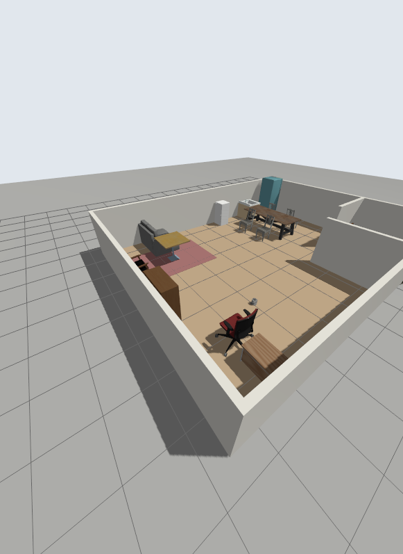
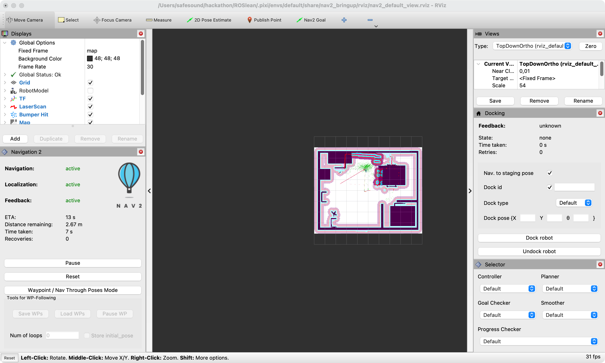

# Tutorial: the experiment in Gazebo

Run the Lean-backed `twist_mux` on a TurtleBot3 in Gazebo. A patrol script
or Nav2 supplies commands. The keyboard can take over, and a stop lock
blocks both sources.

Allow about 20 minutes after setup. If you built the project in the
[turtlesim tutorial](TUTORIAL.md), skip to step 3. The furnished demo was
checked on macOS arm64. The Linux x86-64 run used Xvfb, software rendering,
and a room without furniture.



## 1. Install the two tools

```sh
# Lean's toolchain manager. Accept the defaults.
curl https://elan.lean-lang.org/elan-init.sh -sSf | sh

# pixi, which installs ROS 2 Jazzy, Gazebo and Nav2 into the project folder.
curl -fsSL https://pixi.sh/install.sh | sh
```

Open a new terminal so that both are on `PATH`, then check with
`lake --version` and `pixi --version`. On Linux you need `curl` and `git`
first (`sudo apt install curl git` on Ubuntu), and a graphical session:
Gazebo's lidar is rendered, so the simulator needs a display even to run
without its window.

## 2. Get the code and build

```sh
git clone -b collision-monitor https://github.com/Beneficial-AI-Foundation/ROSlean.git
cd ROSlean
pixi run build
```

The first build downloads the ROS environment and the Lean toolchain. It
ends with `Summary: 4 packages finished`. All commands below are run in this
folder.

## 3. What is in the simulation

```
planner (priority 10)  ─┐
teleop  (priority 100) ─┼─▶ twist_mux ─▶ base watchdog ─▶ robot
e-stop lock (255)      ─┘
```

- **The robot** is a TurtleBot3 "burger": a two-wheeled disc about 14 cm
  across with a lidar on top. It is small; look for a grey disc on the
  floor.
- **The apartment** is 9 m by 7 m: a sofa, armchair and coffee table on a
  rug, a bookshelf, a dining table with four chairs, a kitchen corner with a
  fridge, a desk with an office chair, and a bedroom behind a partition.
- **The planner** drives the robot around by itself. It has the lowest
  priority.
- **Teleop** is your keyboard. It outranks the planner. An input counts as
  live for 0.5 s after its last message.
- **The e-stop** is a lock. While it is on, every input below its priority
  is dropped.
- **The base watchdog** stands in for the robot's own firmware; step 6
  explains why it is there.

The mux configuration is
`ros/roslean_twist_mux/demo/gazebo/gazebo.yaml`.

## 4. Experiment 1: patrol, keyboard, e-stop

### Start it

Terminal 1:

```sh
pixi run gazebo
```

A Gazebo window opens. The very first launch downloads the furniture models
from Gazebo's online library (about 100 MB, cached in `~/.gz/fuel`), so the
room can take a minute to fill in. After about 15 seconds the camera moves to
a view of the whole apartment and the robot starts to drive a rectangle
through the open part of the room.

To look around: scroll to zoom, drag with the right button to orbit, drag
with the left button to pan.

Terminal 1 also shows the narrator, which reports who is driving and names
the theorem that explains it:

```
>>> planner drives: it is the only live input and no lock is active
    theorem forward_of_highest_live
```

macOS may ask whether to allow incoming network connections; allow it.

On Linux without a graphics card Gazebo falls back to software rendering.
It works, but slowly: on a four-core machine the simulation ran at about
80 % of real time with the patrol and 60 % with Nav2, and the lidar gave 4
scans a second.

### Take over with the keyboard

Terminal 2:

```sh
pixi run gazebo-teleop
```

Keep this terminal focused and hold a key: `i` forward, `,` backward, `j`
and `l` turn. While you hold a key the robot follows the keyboard:

```
>>> teleop drives; planner messages are dropped while teleop is live
    theorems forward_of_highest_live, run_not_forward_of_higher_live
```

The patrol is still publishing ten commands a second; they are being
dropped. Drive the robot somewhere else, for example towards the sofa.

### Let go

Release the key. The robot stops for about half a second, then the patrol
takes it back to its route from wherever you left it:

```
>>> nothing is forwarded: teleop went silent but counts as live until its 0.5 s
    timeout has passed, so the planner is still suppressed
    theorem inputLive_iff_le

>>> planner drives: it is the only live input and no lock is active
    theorem forward_of_highest_live
```

### Emergency stop

Terminal 3:

```sh
pixi run demo-estop
```

The command waits until the mux and the narrator are both listening, sends
the lock message five times and returns after about a second. The robot
stops and stays stopped, whatever the patrol or your keyboard sends:

```
>>> e-stop lock ENGAGED

>>> nothing is forwarded: the e-stop lock (255) is above every input
    theorem not_forward_of_top_lock
```

Try the keyboard in terminal 2: nothing moves. Then:

```sh
pixi run demo-release
```

and the patrol (or the keyboard, if you are holding a key) drives again.

Stop everything with Ctrl-C in terminals 1 and 2 before the next experiment.

## 5. Experiment 2: Nav2 as the planner

Terminal 1:

```sh
pixi run gazebo-nav2
```

Now the low-priority input is Nav2. It finds the robot's position by
matching the lidar against a map of the apartment, plans a path around the
furniture, and publishes velocity commands on `nav_vel`. To the mux this is
just another input; nothing about the mux or its configuration changes.

Allow about half a minute after the windows appear for Nav2 to start. A
small tour script then sends it from place to place (desk, kitchen, sofa,
bedroom door, bookshelf), so the robot keeps moving by itself. Terminal 1
shows lines such as `next stop: kitchen (0.2, 2.4)` and `reached kitchen`
between the narrator's messages.

### The RViz window

A second window, RViz, shows what Nav2 knows:



- black: walls and furniture on the map;
- purple and blue: the cost Nav2 assigns near obstacles, which keeps its
  paths away from them;
- green dots: its estimate of where the robot is;
- red line: the path it plans to drive.

The "Navigation 2" panel on the left shows the distance and time remaining
for the current goal.

### Override Nav2

Use the same commands as before:

```sh
pixi run gazebo-teleop     # terminal 2
pixi run demo-estop        # terminal 3
pixi run demo-release
```

The narrator output is the same as in experiment 1, and so are the theorems:
the mux neither knows nor cares what kind of planner is on its low-priority
input.

One new effect is worth watching. Hold the robot with the keyboard or the
e-stop for more than a few seconds, and Nav2 notices that the robot is not
making progress and gives up on its goal. Terminal 1 shows
`did not reach ...; trying again`, and the tour sends the goal again. The
mux does not tell Nav2 that it is being overridden; Nav2 only sees that the
robot is not doing what it asked.

### Send your own goals

Start without the tour:

```sh
pixi run bash -c 'source install/setup.bash && ros2 launch \
  $(ros2 pkg prefix roslean_twist_mux)/share/roslean_twist_mux/demo/gazebo/gazebo_launch.py \
  planner:=nav2 tour:=false'
```

Then either click "Nav2 Goal" in the RViz toolbar and click and drag on the
map to set a position and heading, or use the command line:

```sh
pixi run gazebo-goal -2.3 -2.3
```

Coordinates are in metres on the map. The room spans x from -4.5 to 4.5 and
y from -3.5 to 3.5, and the robot starts at 0 0, in the middle. Useful
places: desk `-2.3 -2.3`, kitchen `0.2 2.4`, sofa `-2.6 0.6`, bedroom door
`2.0 -0.3`, bookshelf `-3.4 -0.6`.

## 6. What Gazebo shows that turtlesim does not

**The mux never stops the robot; something else must.** When every input is
silent or blocked, the mux publishes nothing. It does not send a stop
command (docs/SPEC.md, rule R13). turtlesim stops on its own after a second
without commands, as a real robot base does. Gazebo's drive does not: it
keeps executing the last command it received. When this demo was first put
together, engaging the e-stop made the mux go silent, correctly, and the
robot rolled on across the room.

The base watchdog (`demo/gazebo/base_watchdog.py`) fixes that. It passes the
mux output to the robot and sends zero velocity once the mux has been silent
for 0.3 s. It plays the part of the robot's firmware and is ordinary,
unverified code. The theorems say when a message is forwarded; that the
robot stops when none is, they leave to the base (SPEC, assumption A3). To
see the difference, change `TIMEOUT` in `base_watchdog.py` to a large value
such as `1000`, restart, and engage the e-stop while the robot is moving.

**Wheel odometry is not a position.** The patrol script first steered by
counting wheel turns and was in the wrong room within one lap, because the
wheels slip when the robot turns. It now takes the robot's true position
from the simulator, which a real robot cannot do. Nav2 does it properly,
with the lidar and a map.

**A lidar sees legs, not furniture.** The lidar scans a plane 17 cm above
the floor. Of a dining table it sees four legs. Nav2 at first planned a path
under the table and got stuck between the chair legs. The map now marks the
sofa, armchair, bed and dining set as solid.

## 7. What you just saw

| You did | The robot | Theorem |
| --- | --- | --- |
| Nothing | Follows the planner | `forward_of_highest_live` |
| Held a key | Follows the keyboard; planner commands are dropped | `run_not_forward_of_higher_live` |
| Released the key | Pauses 0.5 s, then follows the planner again | `inputLive_iff_le` |
| Engaged the e-stop | Stops, because nothing is forwarded and the base watchdog brakes | `not_forward_of_top_lock` |

The theorems are about the Lean function `step`, which the node calls for
every message. [THEOREMS.md](THEOREMS.md) lists them with their statements.

## 8. Go further

**Run the original node instead.** Add `mux_package:=twist_mux` to either
launch command to use upstream's `twist_mux`; the behaviour should be the
same:

```sh
pixi run bash -c 'source install/setup.bash && ros2 launch \
  $(ros2 pkg prefix roslean_twist_mux)/share/roslean_twist_mux/demo/gazebo/gazebo_launch.py \
  mux_package:=twist_mux'
```

**Watch what reaches the robot.** `cmd_vel_mux` is the mux output and
`cmd_vel` is what the watchdog passes on:

```sh
pixi run bash -c 'source install/setup.bash && ros2 topic echo /cmd_vel_mux'
```

**Make the e-stop useless.** In `demo/gazebo/gazebo.yaml` give `teleop`
priority 255 and restart. The e-stop no longer stops the keyboard, because a
lock blocks only *strictly* lower priorities. The node warns about this when
it starts.

**Move the furniture.** Edit the poses in `demo/gazebo/apartment.sdf`. For
Nav2, regenerate the map afterwards: start `pixi run gazebo`, and in another
terminal run

```sh
pixi run bash -c 'source install/setup.bash && python3 \
  ros/roslean_twist_mux/demo/gazebo/make_map.py ros/roslean_twist_mux/demo/gazebo'
```

It listens for two minutes while the robot patrols, then writes the map.

## If something goes wrong

| Symptom | Likely cause |
| --- | --- |
| The room is half empty | The furniture is still downloading on the first launch. |
| Gazebo exits a few seconds after the first launch, with `Failed to download model` and `Unable to find uri[https://fuel.gazebosim.org/...]` | The furniture could not be downloaded: there is no internet connection, or a firewall or proxy blocks `fuel.gazebosim.org`. The world does not load without it. Once downloaded, the models are kept in `~/.gz/fuel` and later launches work offline. |
| `Segmentation fault` in `gz sim` at start, with `Ogre2RenderEngine` in the trace (Linux) | There is no display. Gazebo renders the lidar, so it needs a graphical session even with `gui:=false`. Run it from a terminal on the desktop, not over plain SSH. |
| The robot moves in slow motion (Linux) | No graphics card is in use and Gazebo renders in software. The percentage at the bottom of the Gazebo window is the speed relative to real time. |
| `pixi run demo-estop` prints `Waiting for at least 2 matching subscription(s)` and does not return | The simulation is not running (terminal 1). Stop the command with Ctrl-C. |
| I cannot find the robot | It is small. Zoom in on the middle of the room; in experiment 1 it circles between the rug and the bedroom wall. |
| The keyboard does nothing | Terminal 2 is not focused, or the key is not held: one key press is one message, and teleop expires 0.5 s later. |
| With Nav2 the robot does not move at first | Nav2 takes about half a minute to start; wait for `next stop:` in terminal 1. |
| `did not reach ...; trying again` without my doing anything | Some Nav2 goals fail on the first attempt in this set-up and succeed on a retry. In a four-minute test about one attempt in three failed. |
| RViz logs `Validation Failed: Sampler error` or `active samplers with a different type refer to the same texture image unit` | Harmless on macOS; the map is drawn correctly. The second message also appears on Linux with software rendering, where the RViz view has not been looked at. |
| Errors and "process has died" when I press Ctrl-C | RViz and some Python nodes exit noisily. Harmless. |
| Narrator prints `UNEXPECTED` | A message was forwarded while the lock was on. That would contradict `not_forward_of_top_lock`; please report it with the terminal output. |
| Something from an earlier run seems to interfere | A simulator process may have survived. Run `pkill -f "gz sim"` and start again. |
